# Clara Martínez Hernández — web de portfolio

[English](README.md) · **Español**

Web de portfolio bilingüe (catalán / castellano) de Clara Martínez Hernández, educadora social, formadora e investigadora en educación sexual, género y trabajo comunitario. Sitio estático hecho con Astro, contenido gestionado en Sanity y desplegado en Cloudflare Pages. Accesibilidad como punto de partida (WCAG 2.2 AA).

| Modo claro | Modo oscuro |
| --- | --- |
| 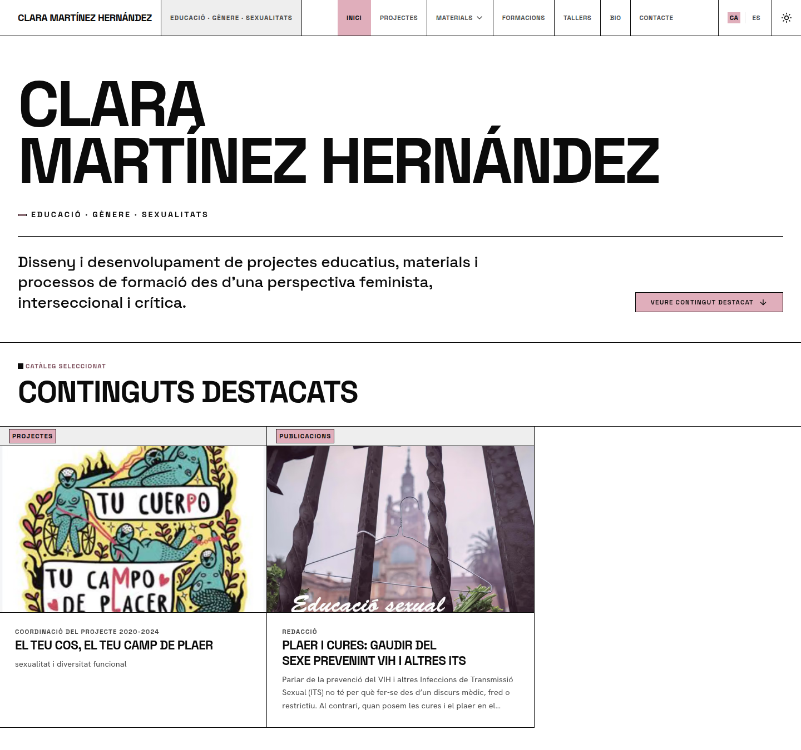 | 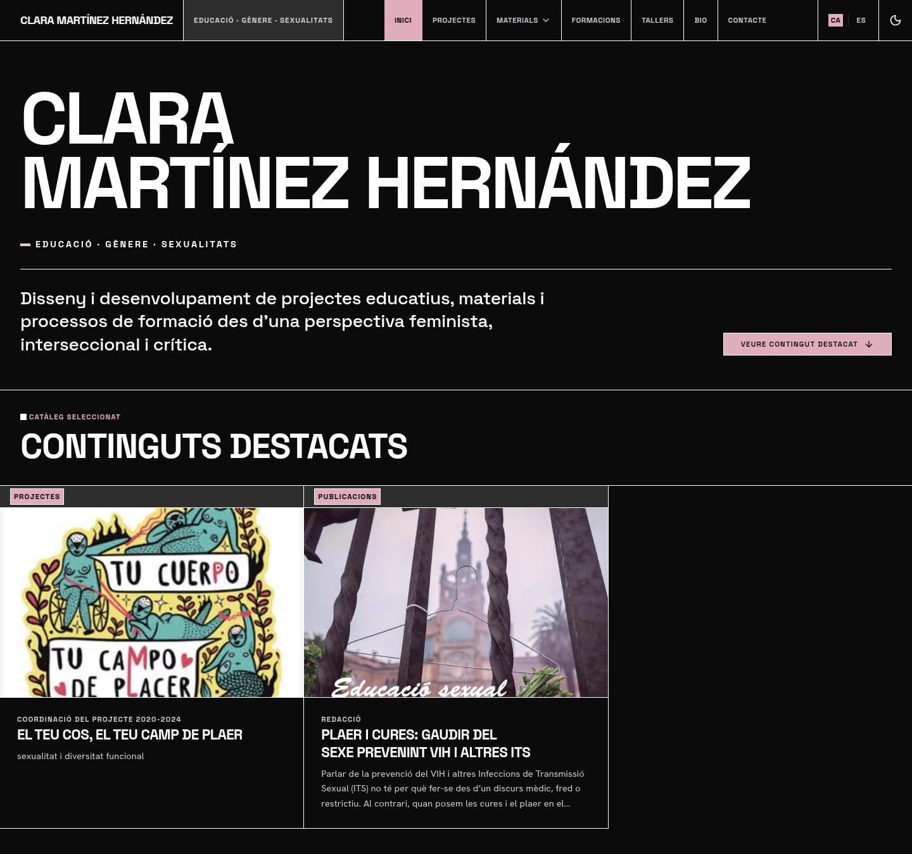 |

## Estado

En desarrollo, todavía sin lanzar. La estructura, las funcionalidades y el flujo de contenido están hechos; el lanzamiento depende de la revisión final de los contenidos, del dominio de producción y de las páginas legales que requiere el formulario de contacto.

## Funcionalidades

- **Bilingüe con URL traducidas.** El catalán es el idioma por defecto en `/` y el castellano vive en `/es/` con sus propios nombres de ruta (`/projectes/` ↔ `/es/proyectos/`). El selector de idioma te mantiene en la misma página, incluidas las fichas cuyo slug es distinto en cada idioma.
- **Catálogo de trabajos.** Proyectos, materiales (cinco subcategorías), formaciones y talleres, con paginación, filtro por etiquetas y barra de subcategorías.
- **Editable por la clienta.** Las fichas del catálogo, la bio, el perfil y la configuración del sitio se editan en Sanity Studio; publicar no requiere tocar código.
- **Accesibilidad.** WCAG 2.2 AA como base: HTML semántico, enlace para saltar al contenido, navegación y menús usables con teclado, foco visible, contraste suficiente en los dos modos y texto alternativo obligatorio desde el CMS.
- **Modo oscuro** basado en tokens con `light-dark()` de CSS, con interruptor manual.
- **SEO.** Metadatos y descripción por página, sitemap y `noindex` en las páginas de utilidad.
- **Formulario de contacto** con Web3Forms, validación en el navegador y estados de error visibles.

## Stack técnico

| Área | Herramientas |
| --- | --- |
| Framework | [Astro](https://astro.build) 7 (salida estática), TypeScript |
| Estilos | Tailwind CSS 4 + SCSS, tokens de diseño en propiedades personalizadas de CSS, escala fluida de tipografía y espaciado ([Utopia](https://utopia.fyi)) |
| Contenido | [Sanity](https://www.sanity.io) 6 (CMS headless) con el plugin de internacionalización de documentos |
| Base | [Accessible Astro Starter](https://github.com/incluud/accessible-astro-starter) y `accessible-astro-components` |
| Formularios | [Web3Forms](https://web3forms.com) |
| Hosting | Cloudflare Pages (despliegue de vista previa por rama) |
| CI | GitHub Actions: `astro check` y build completo en cada pull request |

## Arquitectura

```
.
├── web/        sitio Astro
│   └── src/
│       ├── pages/[...slug].astro   un único router para todas las rutas en los dos idiomas
│       ├── i18n/                   diccionario de textos tipado (ui.ts) y nombres de ruta traducidos (routes.ts)
│       ├── lib/sanity/             consultas GROQ, URL de imágenes, renderizado de Portable Text
│       ├── views/                  una vista por tipo de página
│       └── styles/                 tokens, capa base, utilidades de Tailwind
├── studio/     Sanity Studio (schemas, estructura del menú)
└── docs/adr/   registros de decisiones de arquitectura
```

- **El contenido se obtiene al construir.** El sitio es totalmente estático: las consultas GROQ se ejecutan durante `astro build` (por lotes, para no superar los límites de la API) y el resultado es HTML. Publicar contenido nuevo implica volver a construir el sitio.
- **Un solo router para los dos idiomas.** `getStaticPaths` genera todas las páginas (estáticas, listados paginados, páginas por etiqueta y fichas) desde un único archivo, con una tabla de segmentos de ruta traducidos. No hay páginas duplicadas en `/es/`.
- **Traducciones tipadas.** Todos los textos de la interfaz están en un diccionario; `t()` solo acepta claves que existen, así que una errata es un error de tipos que detecta `astro check`.

## Modelo de contenido y salvaguardas editoriales

Un único tipo de documento, `catalogItem`, cubre las cuatro secciones (proyectos, materiales, formaciones y talleres), de modo que una plantilla de tarjeta y una de detalle sirven para todo el sitio. En el editor los campos están agrupados (tarjeta, portada, taxonomía, detalle, multimedia, botón y secciones libres).

Los schemas están pensados para que la editora no pueda publicar algo que rompa el sitio:

- Todas las imágenes requieren texto alternativo.
- La subcategoría solo aparece, y solo es obligatoria, en los materiales.
- Un vídeo es o una URL externa o un archivo subido, nunca las dos cosas; el botón de acción es o un enlace o una descarga, nunca las dos cosas.
- Una vez publicada una ficha, su slug queda bloqueado, para que las URL compartidas sigan funcionando.
- Los enlaces dentro del texto enriquecido solo aceptan `http`, `https`, `mailto` y `tel`.
- Las etiquetas son documentos propios, con el texto y el slug en los dos idiomas, para que la misma etiqueta se pueda filtrar en catalán y en castellano sin duplicados.

Pensado para la editora:

- Todo el Studio está en catalán, el idioma de trabajo de la editora, con texto de ayuda donde un campo lo necesita («Número més baix = primer lloc a la portada»).
- Las fichas se destacan en la portada con un interruptor y un orden manual.
- El texto del botón es editable, con ejemplos; elegir «enlace externo» o «descarga» decide si se pide una URL o un archivo.
- El texto enriquecido es mínimo (negrita, cursiva, listas, enlaces y subtítulos) y solo está donde se espera prosa, para que el contenido no pueda romper el diseño.
- Las «secciones libres» (bloques de título y texto) permiten añadir nuevos tipos de información, como equipo, premios o colaboraciones, sin cambiar código.
- Avisos contextuales donde el modelo de datos requiere cuidado, como que las etiquetas no se sincronizan solas entre traducciones.

El Studio tiene dos espacios de trabajo: `production` (contenido real) y `testing` (datos de desarrollo). Ver [`studio/CONTENT-MODEL.md`](studio/CONTENT-MODEL.md) y los ADR [0012](docs/adr/0012-arquitectura-capa-datos-sanity.md) y [0019](docs/adr/0019-etiquetes-com-a-document.md).

| Estructura del menú por secciones | Formulario de ficha con campos obligatorios y ayuda |
| --- | --- |
| 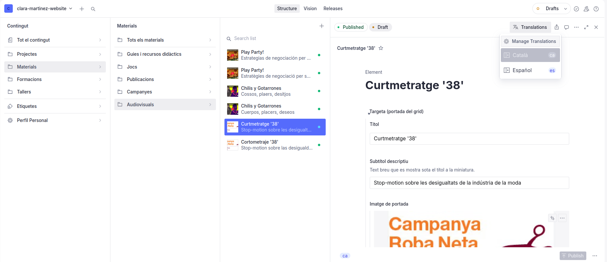 | 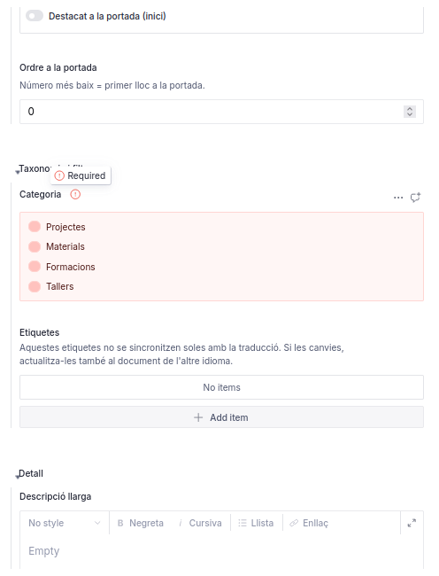 |
| **Slug bloqueado tras publicar** | **Elegir etiquetas bilingües** |
| 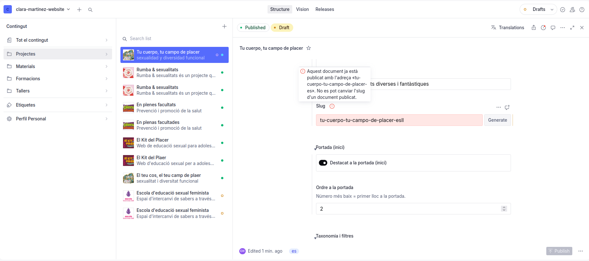 | 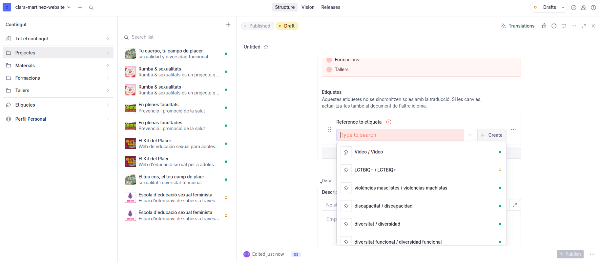 |
| **Botón editable: enlace o descarga** | **Traducciones (catalán / castellano)** |
| 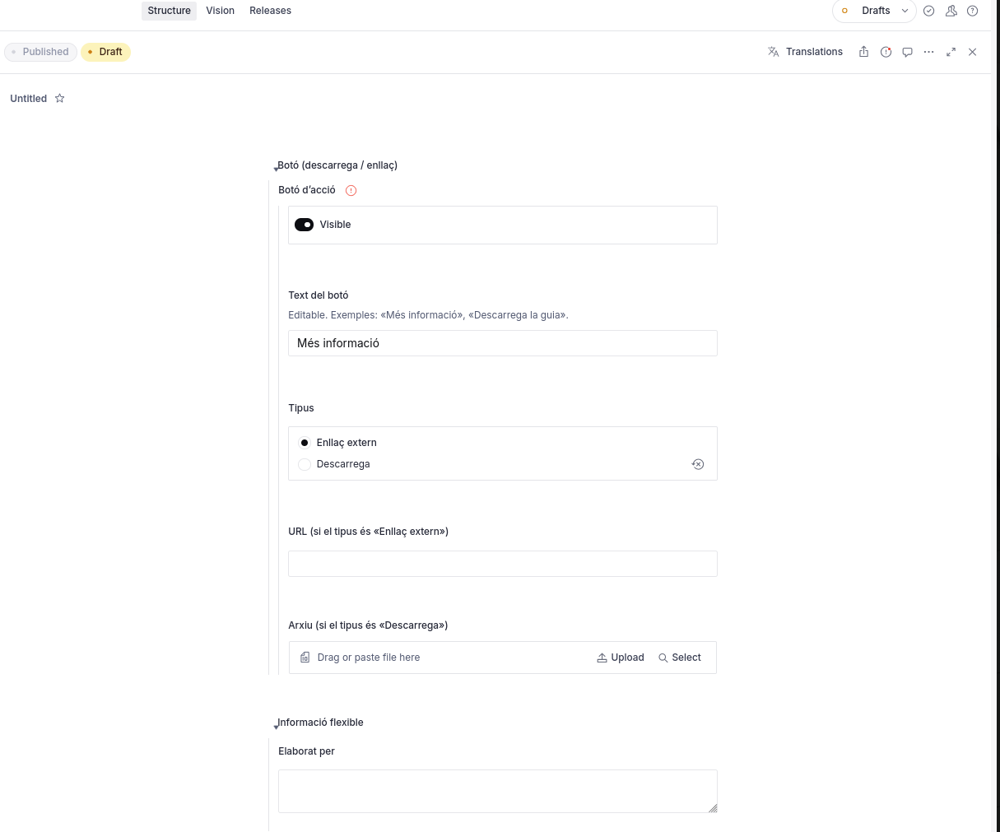 | 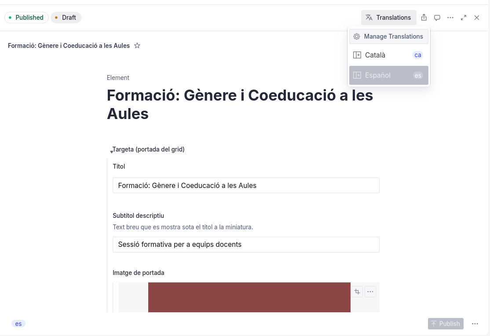 |

## Capturas

| Móvil, modo claro | Móvil, modo oscuro |
| --- | --- |
| 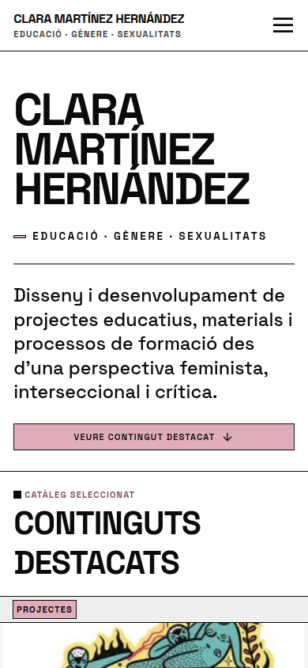 | 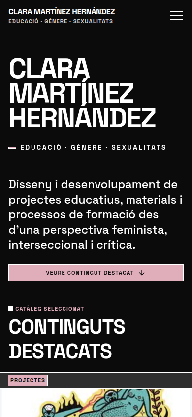 |

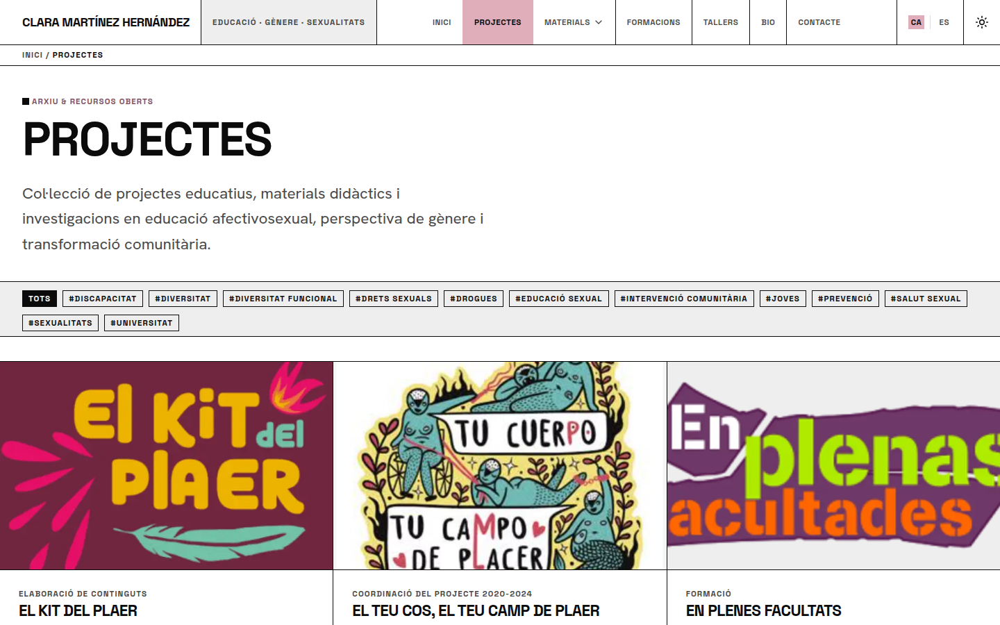

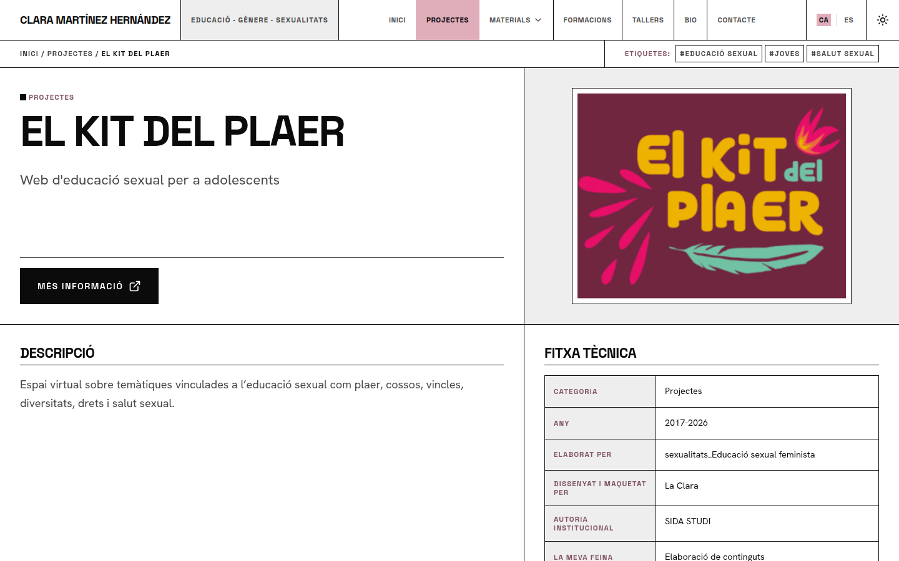

## Puesta en marcha

Requisitos: Node.js en la versión fijada en [`web/.nvmrc`](web/.nvmrc) y npm.

```bash
cd web
nvm use
npm ci
cp .env.example .env   # rellena PUBLIC_SANITY_PROJECT_ID y PUBLIC_SANITY_DATASET
npm run dev            # http://localhost:4321
```

| Comando | Qué hace |
| --- | --- |
| `npm run dev` | Servidor de desarrollo |
| `npm run check` | Comprobación de tipos y plantillas (`astro check`) |
| `npm run build` | Build de producción en `web/dist/` |
| `npm run preview` | Sirve el build de producción en local |

El formulario de contacto necesita además `PUBLIC_WEB3FORMS_ACCESS_KEY`; sin ella, el formulario muestra un aviso de «no configurado» en lugar de fallar en silencio.

El Studio está en `studio/` (`npm ci && npm run dev`) y requiere acceso al proyecto de Sanity.

## Cómo se ha hecho este proyecto

- **Las decisiones están documentadas.** 24 [registros de decisiones de arquitectura](docs/adr/) explican por qué las cosas son como son, incluidas las que más tarde se sustituyeron.
- **Pull requests pequeños** hacia `dev`, cada uno con CI y vista previa en Cloudflare; `dev` pasa a `main` (producción) solo cuando está listo para publicar.
- **Con ayuda de IA, con decisión humana.** El desarrollo se hizo con un agente de programación con IA (Claude Code) que trabaja con un protocolo escrito en [`AGENTS.md`](AGENTS.md): el agente explica cada cambio antes de hacerlo, pregunta antes de tocar configuración o dependencias, nunca hace commit sin aprobación explícita y muestra la salida real de `check` y `build`. El conocimiento del proyecto para el agente vive en skills versionadas en [`.agents/skills/`](.agents/skills/). Las decisiones de diseño y arquitectura las toma la desarrolladora y quedan registradas como ADR.

## Créditos

- **Contenido, textos, imágenes y marca:** Clara Martínez Hernández.
- **Diseño y desarrollo:** [Laura-bf](https://github.com/Laura-bf).

## Licencia

El código se publica bajo la [licencia MIT](LICENSE).

El contenido, los textos, las imágenes, el logo y la marca pertenecen a Clara Martínez Hernández y **no** están cubiertos por esta licencia.
