# Clara Martínez Hernández — portfolio website

**English** · [Español](README.es.md)

Bilingual (Catalan / Spanish) portfolio website for Clara Martínez Hernández, social educator, trainer and researcher in sexuality education, gender and community work. Static site built with Astro, content managed in Sanity, deployed on Cloudflare Pages. Accessibility-first (WCAG 2.2 AA).

| Light | Dark |
| --- | --- |
| 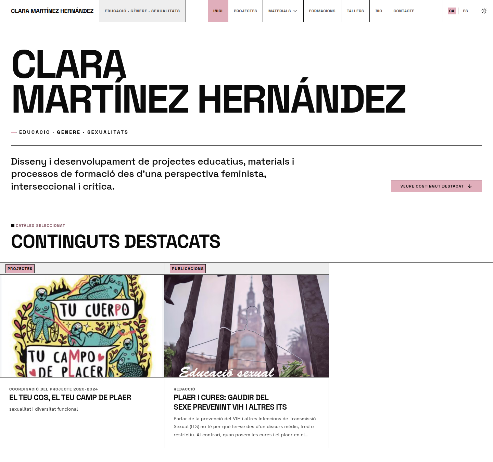 | 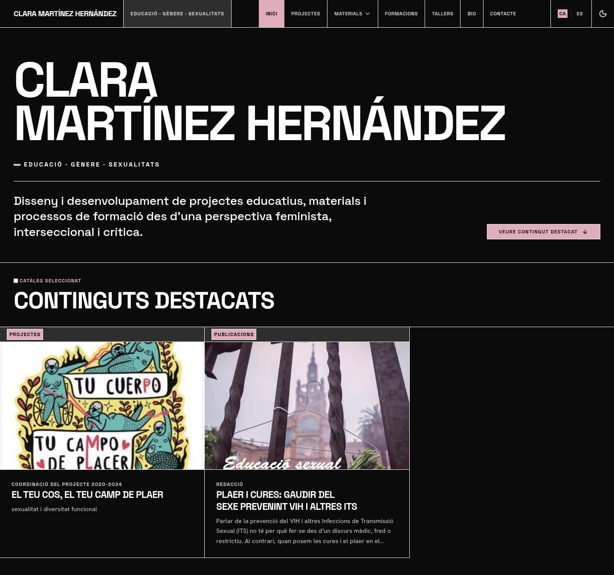 |

## Status

In development, not launched yet. Structure, features and the content workflow are in place; the launch is pending the final content review, the production domain and the legal pages required by the contact form.

## Features

- **Bilingual with translated URLs.** Catalan is the default language at `/`, Spanish lives under `/es/` with its own route names (`/projectes/` ↔ `/es/proyectos/`). The language switcher keeps you on the same page, including content pages whose slug differs per language.
- **Catalog of work.** Projects, materials (five subcategories), trainings and workshops, with pagination, a tag filter and a subcategory bar.
- **Editable by the client.** Every catalog item, the bio, the profile and the site settings are edited in Sanity Studio; no code changes needed to publish.
- **Accessibility.** WCAG 2.2 AA as a baseline: semantic HTML, skip link, keyboard-friendly navigation and menus, visible focus, sufficient contrast in both themes, alt text required by the CMS.
- **Dark mode** built on CSS `light-dark()` tokens, with a manual toggle.
- **SEO.** Per-page metadata and descriptions, sitemap, `noindex` on utility pages.
- **Contact form** via Web3Forms, with client-side validation and visible error states.

## Tech stack

| Area | Tools |
| --- | --- |
| Framework | [Astro](https://astro.build) 7 (static output), TypeScript |
| Styling | Tailwind CSS 4 + SCSS, design tokens in CSS custom properties, fluid type and spacing scale ([Utopia](https://utopia.fyi)) |
| Content | [Sanity](https://www.sanity.io) 6 (headless CMS) with the document internationalization plugin |
| Base | [Accessible Astro Starter](https://github.com/incluud/accessible-astro-starter) and `accessible-astro-components` |
| Forms | [Web3Forms](https://web3forms.com) |
| Hosting | Cloudflare Pages (preview deployment per branch) |
| CI | GitHub Actions: `astro check` and a full build on every pull request |

## Architecture

```
.
├── web/        Astro site
│   └── src/
│       ├── pages/[...slug].astro   single router for every route in both languages
│       ├── i18n/                   typed UI dictionary (ui.ts) and translated route names (routes.ts)
│       ├── lib/sanity/             GROQ queries, image URLs, Portable Text renderer
│       ├── views/                  one view per page type
│       └── styles/                 tokens, base layer, Tailwind utilities
├── studio/     Sanity Studio (schemas, desk structure)
└── docs/adr/   architecture decision records
```

- **Content is fetched at build time.** The site is fully static: GROQ queries run during `astro build` (in batches, to stay within API limits) and the output is plain HTML. Publishing new content means rebuilding the site.
- **One router for both languages.** `getStaticPaths` generates every page — static pages, paginated listings, tag pages and item pages — from a single file, using a table of translated route segments. No duplicated pages under `/es/`.
- **Typed translations.** All interface text lives in one dictionary; `t()` only accepts existing keys, so a typo is a type error caught by `astro check`.

## Content model & editorial safeguards

A single document type, `catalogItem`, covers the four sections (projects, materials, trainings, workshops), so one card template and one detail template serve the whole site. Fields are grouped in the editor (card, home page, taxonomy, details, media, button, free sections).

The schemas are designed so the editor can't publish something that would break the site:

- Every image requires alt text.
- The subcategory is shown and required only for materials.
- A video is either an external URL or an uploaded file, never both; the call-to-action button is either a link or a download, never both.
- Once an item is published its slug is locked, so shared URLs keep working.
- Links inside rich text only accept `http`, `https`, `mailto` and `tel`.
- Tags are their own documents, with the text and the slug in both languages, so the same tag can be filtered in Catalan and Spanish without duplicates.

Built for the editor:

- The whole Studio is in Catalan, the editor's working language, with help text where a field needs it ("Lower number = first on the home page").
- Items are featured on the home page with a switch and a manual order.
- The button text is editable, with examples; choosing "external link" or "download" decides whether a URL or a file is asked for.
- Rich text is kept minimal (bold, italic, lists, links and subheadings) and only where prose is expected, so content can't break the layout.
- Free "sections" (title + text blocks) let the editor add new kinds of information, such as team, awards or partners, without code changes.
- Contextual warnings where the data model needs care, such as tags not syncing automatically between translations.

The Studio has two workspaces: `production` (real content) and `testing` (development data). See [`studio/CONTENT-MODEL.md`](studio/CONTENT-MODEL.md) and ADRs [0012](docs/adr/0012-arquitectura-capa-datos-sanity.md) and [0019](docs/adr/0019-etiquetes-com-a-document.md).

| Desk structure by section | Item form with required fields and help text |
| --- | --- |
| 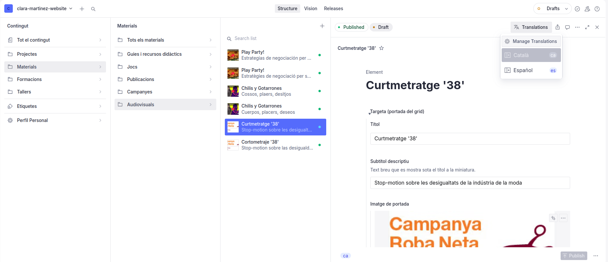 | 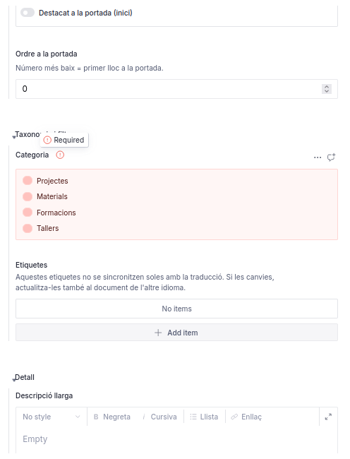 |
| **Slug locked after publishing** | **Picking bilingual tags** |
| 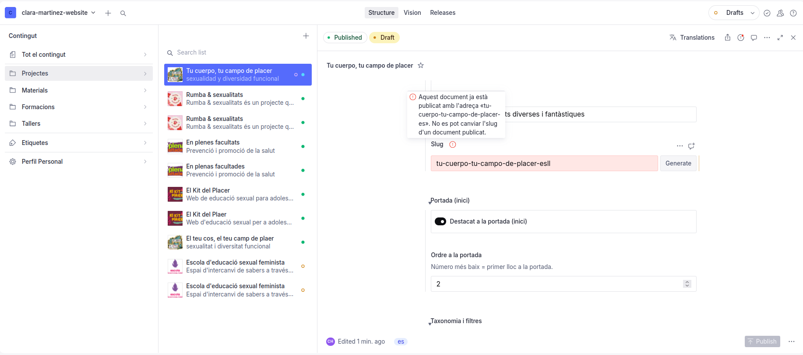 | 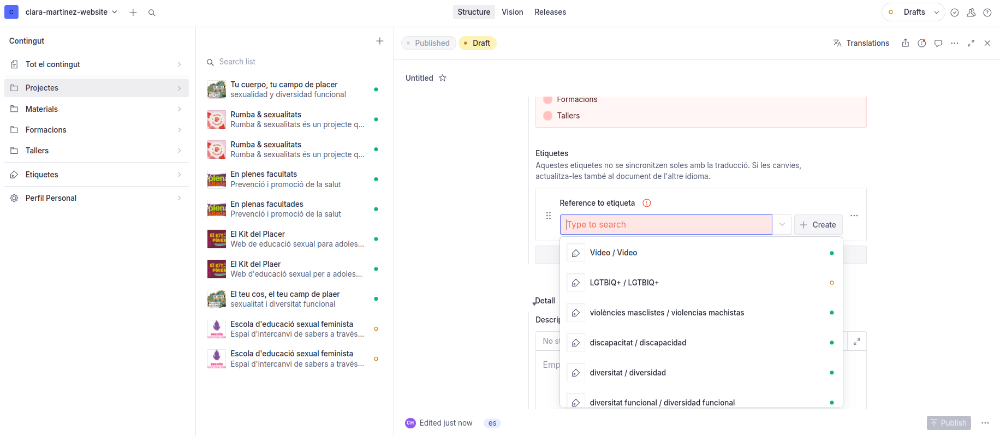 |
| **Editable button: link or download** | **Translations (Catalan / Spanish)** |
| 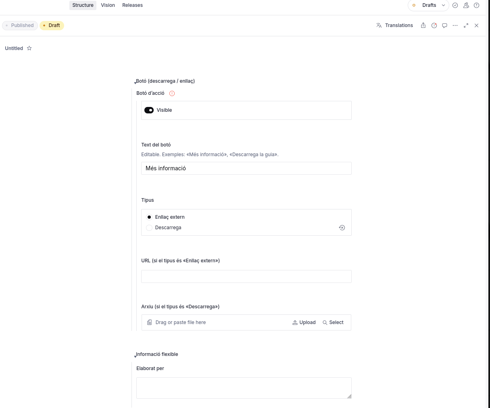 | 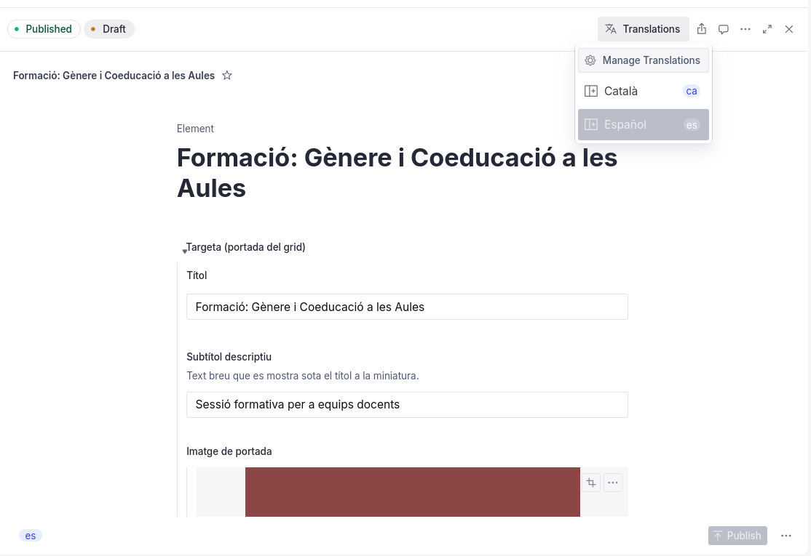 |

## Screenshots

| Mobile, light | Mobile, dark |
| --- | --- |
| 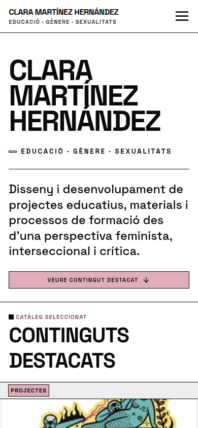 | 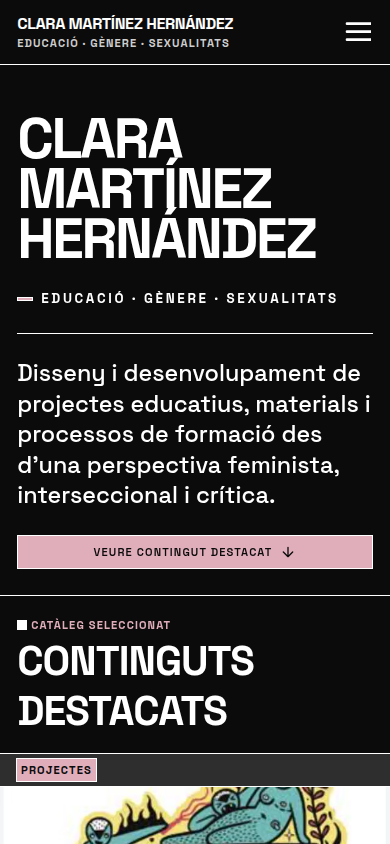 |

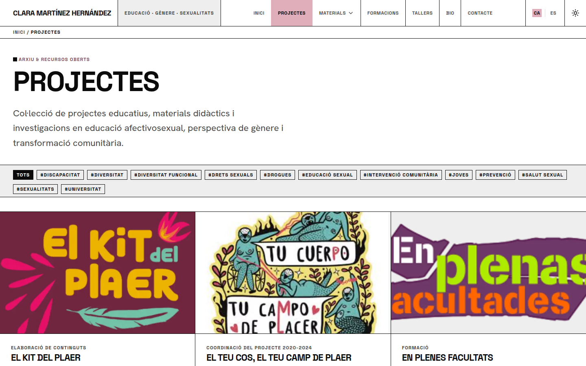

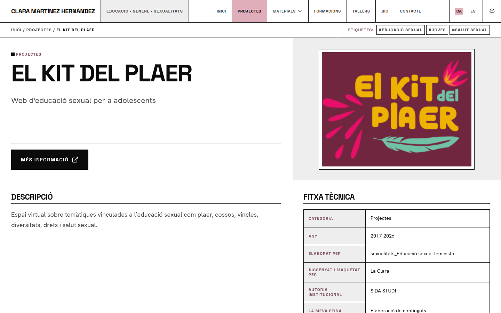

## Getting started

Requirements: Node.js as pinned in [`web/.nvmrc`](web/.nvmrc) and npm.

```bash
cd web
nvm use
npm ci
cp .env.example .env   # set PUBLIC_SANITY_PROJECT_ID and PUBLIC_SANITY_DATASET
npm run dev            # http://localhost:4321
```

| Command | What it does |
| --- | --- |
| `npm run dev` | Development server |
| `npm run check` | Type and template checks (`astro check`) |
| `npm run build` | Production build to `web/dist/` |
| `npm run preview` | Serve the production build locally |

The contact form also needs `PUBLIC_WEB3FORMS_ACCESS_KEY`; without it the form shows a "not configured" message instead of failing silently.

The Studio lives in `studio/` (`npm ci && npm run dev`) and requires access to the Sanity project.

## How this project was built

- **Decisions are documented.** 24 [architecture decision records](docs/adr/) (in Spanish) explain why things are the way they are, including the ones that were later replaced.
- **A session journal** keeps the process: what was done, decisions, verification and next steps, one entry per working session. Each session closes by reviewing whether any decision needs an ADR, and a `/retomar` command lets the agent resume from the last entry in a fresh chat. The journal stays private because it holds personal data and infrastructure details.
- **Small pull requests** into `dev`, each with CI and a Cloudflare preview; `dev` is promoted to `main` (production) only when it's ready to ship.
- **AI-assisted, human-led.** Development was done with an AI coding agent (Claude Code) working under a written protocol in [`AGENTS.md`](AGENTS.md): the agent explains each change before making it, asks before touching configuration or dependencies, never commits without explicit approval, and reports the real output of `check` and `build`. Project knowledge for the agent lives in versioned skills under [`.agents/skills/`](.agents/skills/). Design and architecture decisions are made by the developer and recorded as ADRs.

## Credits

- **Content, texts, images and brand:** Clara Martínez Hernández.
- **Design and development:** [Laura-bf](https://github.com/Laura-bf).

## License

The code is released under the [MIT License](LICENSE).

The content, texts, images, logo and brand belong to Clara Martínez Hernández and are **not** covered by this license.
